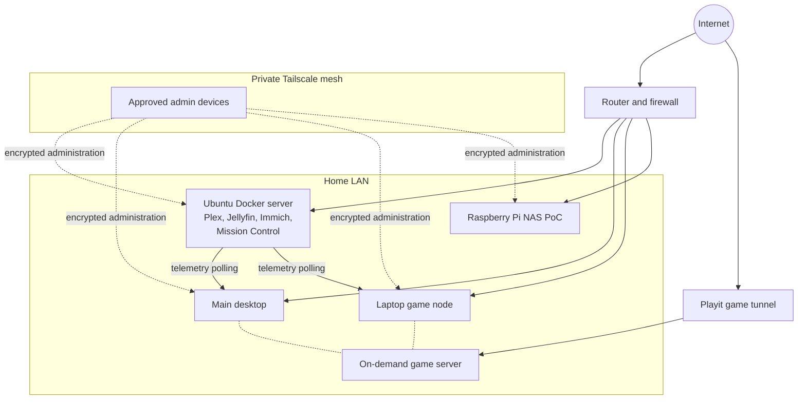

# Network topology

The homelab has two ways in from outside the house:

- The Tailscale mesh carries administration traffic between approved devices.
- A Playit tunnel forwards one game-server port to players who are not on the tailnet. It reaches nothing else.

## Trust boundaries

- Immich and Jellyfin bind only to the server's Tailscale address. Plex uses host networking, so the host firewall limits port 32400 to the `tailscale0` interface.
- SSH and admin interfaces accept connections only from the LAN or the tailnet.
- The Playit tunnel forwards only the port of the game server it is configured for.
- Mission Control telemetry agents listen only on the LAN and the tailnet.
- This public copy leaves out secrets, private addresses, device identifiers, and Tailscale policy.
