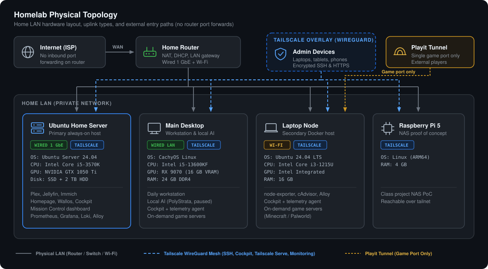
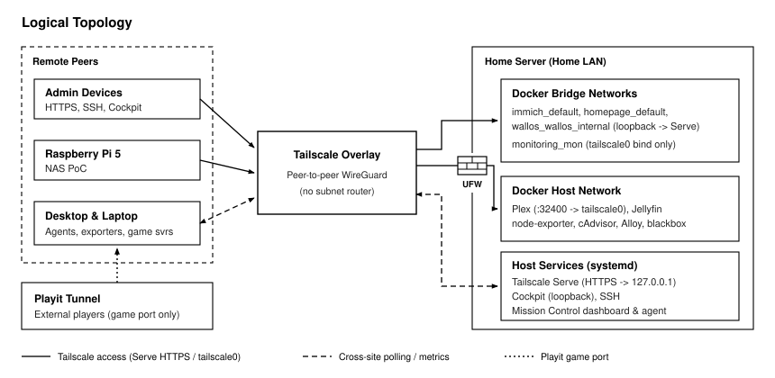
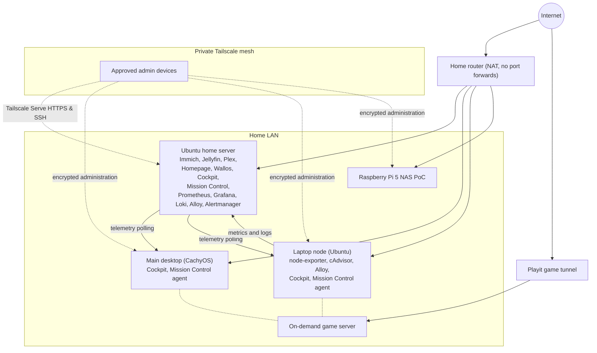

# Network topology

The homelab has two entry paths from outside the house:

- The Tailscale WireGuard mesh carries administration and service access between approved devices.
- A Playit tunnel forwards one game-server port to players outside the tailnet and reaches nothing else.

The router forwards no inbound ports for any service.

## Physical topology

| Host | Uplink | Hardware | Role |
|---|---|---|---|
| Ubuntu home server | Wired 1 GbE | Intel Core i5-3570K, NVIDIA GTX 1050 Ti, SSD + 2 TB HDD | Primary always-on Docker host, media, photos, monitoring, Mission Control dashboard |
| Main desktop | Wired LAN | Intel Core i5-13600KF, 24 GB DDR4, AMD Radeon RX 9070 (16 GB VRAM), CachyOS | Daily workstation, local AI workloads (paused), on-demand game servers |
| Laptop node | Wi-Fi | Intel Core i3-1215U, 16 GB RAM, Ubuntu 24.04 LTS | Secondary Docker host (monitoring agents) and on-demand game servers |
| Raspberry Pi 5 | LAN | 4 GB model | NAS proof of concept |

## Logical and Docker topology

## Docker networking and Tailscale connectivity

On the Ubuntu home server, Compose stacks use isolated bridge networks where possible and host networking only where local discovery or host metrics require it:

| Stack / Service | Docker network | Live binding | Access path |
|---|---|---|---|
| Immich (`immich_server`, ML, Postgres, Redis) | `immich_default` (bridge) | `127.0.0.1:2283` | Tailscale Serve HTTPS (`:443`) and TCP (`:2283`) |
| Homepage (nginx proxy + dashboard) | `homepage_default` (bridge) | `127.0.0.1:3010` | Tailscale Serve HTTPS (`:8443`) |
| Wallos | `wallos_wallos_internal` (bridge) | `127.0.0.1:8282` | Tailscale Serve HTTPS (`:10443`) |
| Grafana, Prometheus, Loki, Alertmanager | `monitoring_mon` (bridge) | `tailscale0` IP only (`:3000`, `:9090`, `:3100`, `:9093`) | Direct over tailnet |
| Plex | `host` | `:32400` + GDM discovery | Host firewall restricts `:32400` to `tailscale0` |
| Jellyfin | `host` | `:8096` | Behind host firewall |
| `node-exporter`, `cAdvisor`, `Alloy`, `blackbox` | `host` | Host stack | Metrics scraped by Prometheus, logs pushed to Loki |
| Cockpit (all Linux hosts) | Native systemd | `127.0.0.1:9091` on home server | Tailscale Serve HTTPS (`:9443`) and tailnet access |
| Mission Control | Native systemd | Dashboard `:8080`, agents `:4242` | LAN and tailnet polling |

## Trust boundaries

- In this repository's templates, Immich and Jellyfin bind only to the server's Tailscale address. On the live server, Immich, Homepage, Wallos, and Cockpit publish to loopback and Tailscale Serve terminates HTTPS for the tailnet. Jellyfin runs with host networking behind the host firewall, and Plex uses host networking in both the template and live setup with the host firewall limiting port `32400` to `tailscale0`.
- Grafana, Prometheus, Loki, and Alertmanager bind directly to the home server's `tailscale0` address rather than `0.0.0.0`.
- SSH and admin interfaces accept connections only from the LAN or the tailnet.
- The Playit tunnel forwards only the port of the active game server.
- Mission Control telemetry agents listen only on the LAN and the tailnet.
- Prometheus, Grafana, Loki, Alloy, Alertmanager, Homepage, and Wallos run on the live hosts outside the three Compose templates in this repository.
- This public copy leaves out secrets, private IP addresses, `.ts.net` hostnames, MAC addresses, and Tailscale ACL policy.
